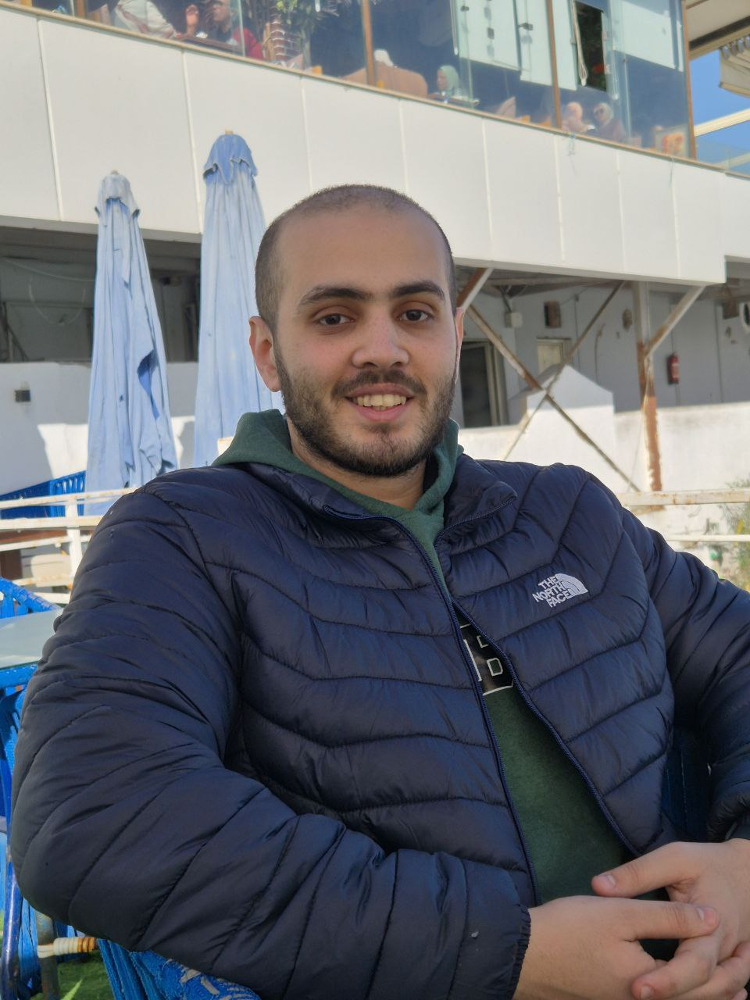
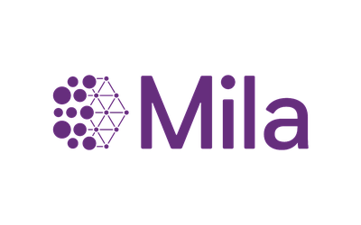

  
  

I'm a research Master's student in computer engineering at [Polytechnique Montréal](https://www.polymtl.ca/) and [Mila](https://mila.quebec/en/), working in the [DAIS lab](https://github.com/dais-labo).

Before that, I was a GenAI Engineer at EnergyAI in Berlin, building multi-agent LLM systems, and an Applied Scientist at Microsoft, working on the language-model inference engine behind SwiftKey. Earlier, I worked on embedded systems at Siemens, databases at ITTIA, and HPC at Brightskies.

My research interests include LLM-powered data systems, efficient LLM inference, and query optimization.

  

  <a href="mailto:eyad.salama@mila.quebec" style="text-decoration: underline;">eyad.salama@mila.quebec</a> | <a href="mailto:esalama057@proton.me" style="text-decoration: underline;">esalama057@proton.me</a> | <a href="https://linkedin.com/in/esalama" style="text-decoration: underline;">LinkedIn</a> | <a href="https://github.com/izarrios" style="text-decoration: underline;">GitHub</a> | <a href="cv.pdf" target="_blank" style="text-decoration: underline;">CV</a>

## Education

**Master of Science, Computer Engineering** | Polytechnique Montréal Montréal, QC, Canada | May 2026 – Present

**Bachelor of Science, Computer and Communication Engineering** | Alexandria University Alexandria, Egypt | Sep 2019 – Jul 2024

## Experience

**Research Master's Student** |  Mila - Quebec AI Institute   Québec, Canada | May 2026 – Present   Cost-efficient semantic query processing over LLMs; working on [Flock](https://github.com/dais-labo/flock) and FFX

**GenAI Engineer** |  EnergyAI Berlin   Berlin, Germany | Aug 2025 – Feb 2026   Multi-agent LLM system for [GridOS](https://energyai.berlin/gridos) on Google ADK and Vertex AI; training-data pipelines and model fine-tuning

**Applied Scientist** |  Microsoft   Cairo, Egypt | Jul 2024 – Aug 2025   SwiftKey's NLP inference engine: GPT-2 support, evaluation tooling, and lower inference latency

**Embedded Software Engineer** |  Siemens   Cairo, Egypt | Sep 2023 – Jul 2024   AUTOSAR CAN communication stack and FOTA bootloader

**Software Engineer** |  ITTIA   Bellevue, USA | Oct 2023 – Jul 2024   Database performance optimization and an analytics dashboard

**High Performance Computing Intern** |  Brightskies   Alexandria, Egypt | Jul 2023 – Sep 2023   Seismic data processing with parallel I/O and CUDA

## Teaching

**INF3710: Files and Databases** | Polytechnique Montréal Montréal, QC, Canada | Fall 2026

- TA for Professor Amine Mhedhbi

## Open Source Contributions

  
  
  
  
  

## Skills

C++, PyTorch, Machine Learning, Artificial Intelligence, CUDA, Triton, Python, Go, Rust, C, OMP, ONNX Runtime, MPI, Make, CMake, Ninja, Scons, Java, Scala, Docker, Git, Typescript, React

## Certifications

- **Databricks Certified Machine Learning Professional** - Databricks
- **Databricks Certified Machine Learning Associate** - Databricks
- **Databricks Certified Generative AI Engineer Associate** - Databricks
- **Databricks Certified Data Engineer Associate** - Databricks
- **Digital Egypt Pioneers Programs (DEPI)** - Digital Egypt Pioneers Initiative
- **Developing Secure Software** - The Linux Foundation
- **Machine Learning Specialization** - Coursera
- **Advanced Learning Algorithms** - Coursera
- **Supervised Machine Learning: Regression and Classification** - Coursera
- **Unsupervised Learning, Recommenders, Reinforcement Learning** - Coursera
- **AWS Academy Graduate - AWS Academy Cloud Foundations** - Amazon Web Services
